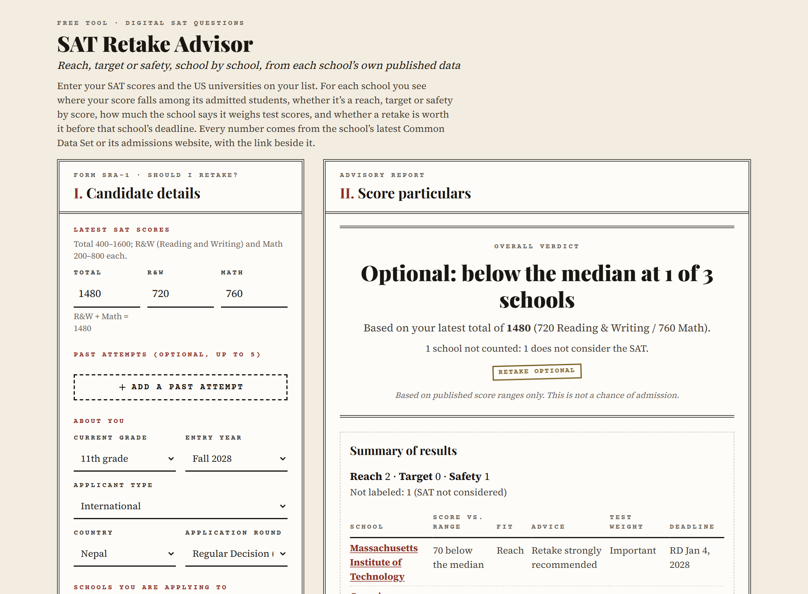
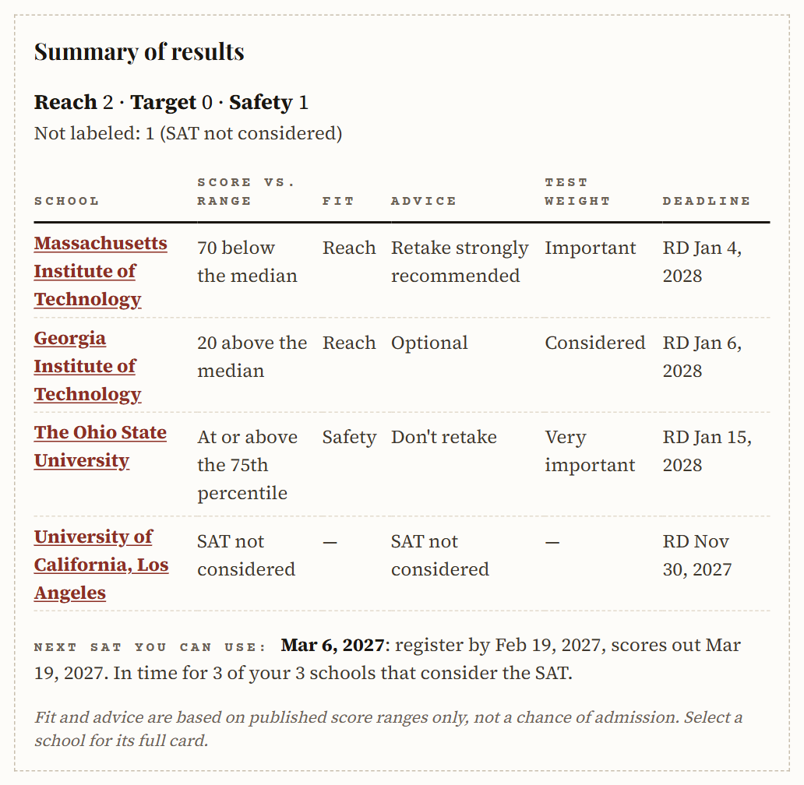
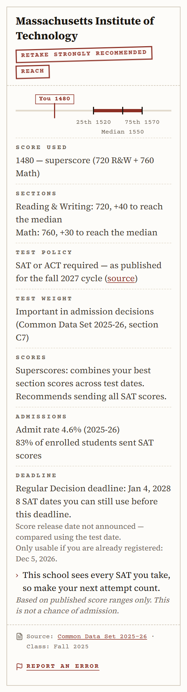

<div align="center">

# SAT Retake Advisor

**Reach, target or safety, school by school, from each school's own published data.**

A free tool for students applying to US universities. Enter your SAT scores and your list of schools, and see for each one where your score falls, whether it's a reach, target or safety by score, and whether a retake is worth it before that school's deadline.

[**Open the tool →**](https://app.satretake.workers.dev)




</div>

## Why it exists

"Should I retake the SAT?" and "Is this school a reach for me?" are the questions asked most often in the [Digital SAT Questions](https://www.facebook.com/groups/941020050656522/) group on Facebook. The usual answers are general advice, or score ranges copied from site to site with no year and no source. This tool answers both questions for each school on a student's list, using numbers the school published itself.

## What you get for each school

| | |
|---|---|
| **Your score against its range** | Where your score sits against the school's 25th, 50th and 75th percentile SAT scores, as a chart and in words |
| **Reach, target or safety** | Worked out from the school's published score range and admit rate |
| **Retake advice** | Retake strongly recommended, Retake if you have time, Optional, Don't retake, or No time to retake |
| **Test weight** | How much the school says it weighs test scores (Common Data Set, section C7) |
| **Your score as the school counts it** | Your superscore if the school superscores, otherwise your best single test date |
| **Test policy** | Required, optional or not considered for your entry year, for domestic and international applicants |
| **Deadlines and test dates** | ED, EA and RD deadlines for the current cycle, and which official SAT dates still get your scores there in time |

The report also has a summary of the whole list, a test calendar, and a **Save as PDF** option that can print the student's name on the report without sending or storing it.

<table>
<tr>
<td width="62%" valign="top"></td>
<td width="38%" valign="top"></td>
</tr>
</table>

## How reach, target and safety are worked out

- **Reach:** your score is below the school's median, or the school admits fewer than 15% of applicants.
- **Target:** your score is between the median and the 75th percentile.
- **Safety:** your score is at or above the 75th percentile and the school admits at least 30% of applicants. Otherwise it stays a Target.

Retake advice comes from the same ranges, then changes to "No time to retake" when no SAT date you can still register for gets scores to the school before its deadline. Schools that don't consider the SAT, or whose ranges aren't verified yet, get no label.

> [!NOTE]
> Labels are based on published score ranges only. They are not a chance of admission. Grades, essays, activities and recommendations matter too.

## Where the data comes from

| Data | Source |
|---|---|
| SAT ranges, admit rates, share of students sending SAT scores, test weight | Each school's latest [Common Data Set](https://commondataset.org/) (sections C1, C7 and C9) |
| Deadlines, test policy, superscoring and score sending | The school's official admissions website, checked for the 2026–27 cycle |
| SAT dates, registration deadlines and score release dates | College Board |

Every value in [`data/schools.json`](data/schools.json) has an official source URL and a data year, and the site shows the link next to each number. Nothing is copied from other websites or estimated into the data. A value a school doesn't publish stays empty and the site says "Not published" or "Data not yet verified". When a school publishes no median, the site shows the midpoint of its 25th and 75th percentiles at runtime, marked "estimated".

A schema check ([`src/data/schema.ts`](src/data/schema.ts)) runs before every build and fails it if a record is missing a source or breaks a rule. Open data questions are tracked in [`docs/CHECKLIST.md`](docs/CHECKLIST.md).

Found a wrong number? Use the **Report an error** button on that school's card and include the official source link.

## Privacy

- No login, and the tool never asks for a name or email.
- All the advice is worked out in your browser.
- One anonymous record per browser (scores, grade, entry year, country, round and chosen schools, under a random id) is saved to count usage. No names, emails or IP addresses are stored.
- The name on a saved PDF stays on your device.

## How it's built

| Part | Tools |
|---|---|
| App | React 18, TypeScript (strict), Vite, Tailwind CSS |
| Logic | Pure TypeScript functions in [`src/logic`](src/logic), unit tested with Vitest |
| Data checks | zod schema, run by `npm run check:data` and every build |
| Storage | Firebase Firestore Lite, protected by generated security rules and App Check (reCAPTCHA Enterprise) |
| Hosting | Cloudflare Workers static assets, with a strict Content Security Policy |
| Tests | Vitest, Testing Library and axe-core accessibility checks, plus Firestore rules tests on the emulator |

The design follows a printed score report: Playfair Display, Source Serif 4 and Courier Prime on paper tones, with body text at 16px or more, 44px tap targets and checked colour contrast.

### Project layout

```
data/            schools.json (61 schools) and sat-dates.json
src/logic/       retake labels, superscore, policy, timeline, verdict (with tests)
src/ui/          form, report, school cards, range chart, calendar
src/backend/     anonymous saving, error reports, counters (loaded only when needed)
scripts/         data check, app data build, Firestore rules generator
docs/            spec, data checklist, launch steps
```

## Run it locally

You need Node.js 22 or later.

```bash
git clone https://github.com/BibekSubediCR7/sat-retake-advisor.git
cd sat-retake-advisor
npm install
npm run dev
```

The app works fully without Firebase. Saving switches on only when the `VITE_FIREBASE_*` and `VITE_RECAPTCHA_SITE_KEY` variables from [`.env.example`](.env.example) are set.

| Command | What it does |
|---|---|
| `npm run dev` | Start the dev server |
| `npm test` | Run all unit and component tests |
| `npm run check:data` | Check `data/*.json` against the schema |
| `npm run build` | Data check, rules check, type check and production build |
| `npm run test:rules` | Firestore rules tests on the emulator (needs Java 21) |

## Contributing

Data corrections are the most useful help. Use **Report an error** on the site, or open an issue with the school, the value, and a link to the school's own Common Data Set or admissions page. Corrections from secondary sites can't be accepted.

## Author

Built by **Bibek Subedi**, moderator of the [Digital SAT Questions](https://www.facebook.com/groups/941020050656522/) group.
[LinkedIn](https://www.linkedin.com/in/bibeksubedicr7/) · [GitHub](https://github.com/BibekSubediCR7) · [Support the tool on Buy Me a Momo](https://buymemomo.com/bibeksubedi)

## License

The code is released under the [MIT License](LICENSE).

Not affiliated with or endorsed by College Board or any university. SAT is a trademark of College Board.
